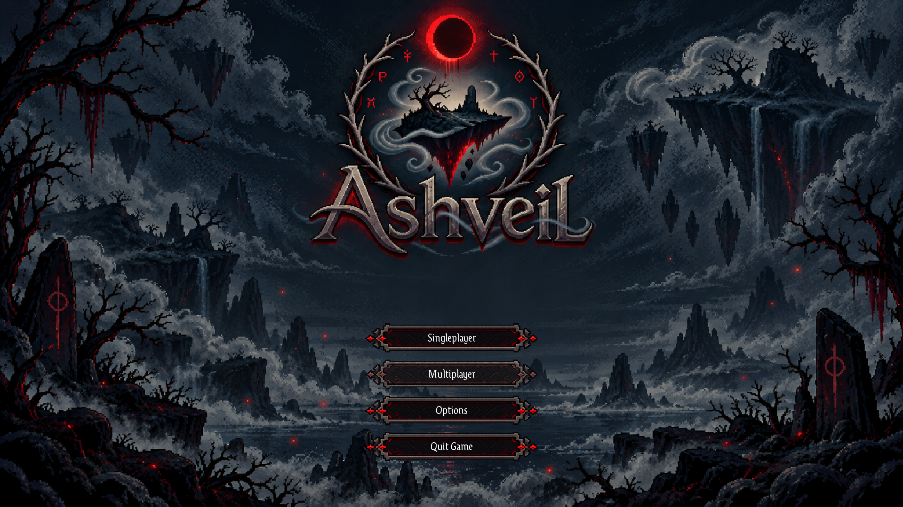
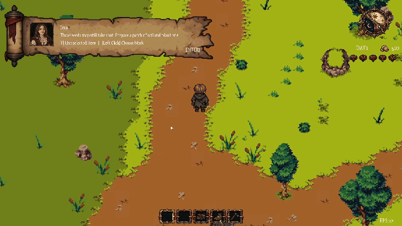
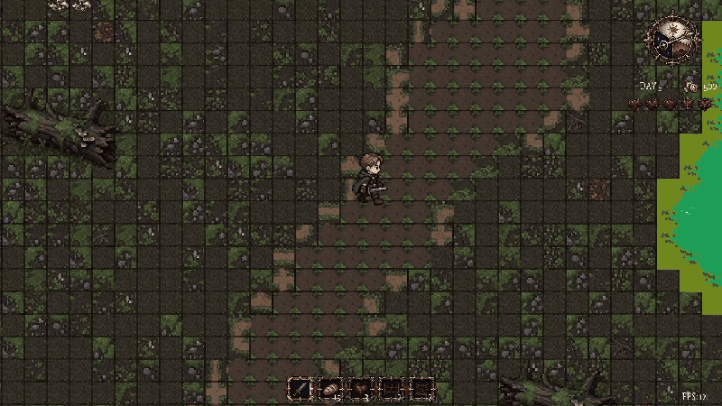
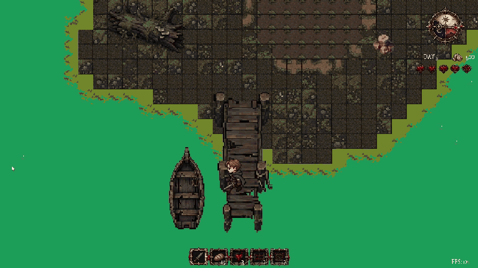
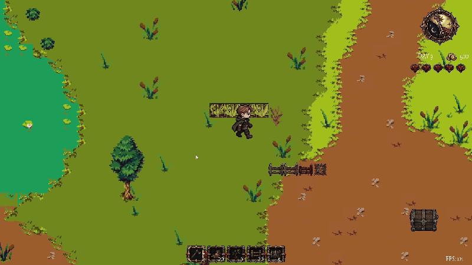

# Ashveil

<p align="center">
  
</p>

<p align="center">
  <strong>A 2D dark-fantasy survival/adventure game built in Java with LibGDX.</strong>
</p>

<p align="center">
  Explore cursed islands, gather resources, prepare during the day, and survive what emerges after dusk.
</p>

<p align="center">
  <b>Java 17</b> · <b>LibGDX</b> · <b>LWJGL3</b> · <b>Scene2D</b> · <b>Tiled</b> · <b>Gradle</b>
</p>

---

## About

**Ashveil** is a single-player desktop survival/adventure game developed in **Java 17** with **LibGDX**.

The project began as an object-oriented programming university project and grew into a larger game with exploration, combat, crafting, farming, building, enemy AI, persistent multi-area world state, special encounters, save/load, settings, localization, and event-driven progression.

A major goal of the codebase is **separation of responsibilities**: gameplay logic, rendering, input, UI, navigation, persistence, and progression are implemented as distinct systems instead of being concentrated inside a single game class.

---

## Gameplay

<p align="center">
  
</p>

Ashveil is built around a day-to-night survival loop.

During the day, the player can explore, gather resources, farm, craft equipment, place structures, organize inventory, and prepare for later encounters. At night, hostile creatures begin to appear and the focus shifts toward combat and survival.

### Current gameplay systems

- real-time top-down movement and directional combat;
- inventory and hotbar management;
- item pickup, dropping, stacking, and storage;
- persistent chest inventories;
- harvesting and tool progression;
- recipe-driven crafting;
- farming and crop growth;
- placeable objects and defensive structures;
- health, healing, death, and gold;
- day/night progression;
- multiple enemy types with distinct behavior;
- projectiles and ranged attacks;
- special multi-wave encounters;
- multiple persistent areas;
- boat and world-map travel;
- contextual guidance through Ceca;
- multi-slot save/load;
- settings and localization infrastructure.

---

## Combat & Enemy AI

<p align="center">
  
</p>

Enemies share common combat and navigation infrastructure while individual enemy types specialize their movement and attacks.

The current enemy roster includes:

- **Shade** — ground-based pursuit and close-range pressure;
- **Wisp** — special movement behavior and fast attacks;
- **Wraith** — ranged attacks using projectiles.

Ground enemies use **BFS-generated distance fields** for navigation. Different traversal rules can be supported without giving every enemy type its own completely separate pathfinding implementation.

Combat itself is separated from rendering and uses shared damage / hittable concepts so enemies and destructible world objects can participate in the same gameplay layer without duplicating unrelated logic.

Special encounters build on top of those systems. **Crimson Veil**, for example, coordinates escalating waves, timers, encounter state, and world restrictions through its own state-driven logic.

---

## World, Areas & Travel

<p align="center">
  
</p>

Ashveil is not limited to a single map. The current world is split into multiple areas with their own runtime state and progression rules.

Current areas include:

- **Main Island**
- **Windy Plains**
- **Darkroot Isle**
- **Veilscar Passage**

The player can travel between unlocked areas through the world-map flow. Each area keeps its own persistent runtime state, so changes can survive leaving the area and returning later.

Progression ties together exploration, travel, encounters, unlocks, and narrative guidance rather than relying on a permanent objective tracker.

---

## Inventory, Crafting & Preparation

<p align="center">
  
</p>

Inventory and crafting are part of the gameplay state rather than UI-only systems.

Items can be:

- gathered from the world;
- stacked and moved between slots;
- transferred between player inventory and chests;
- placed into the hotbar;
- consumed;
- crafted into new equipment;
- used to place or modify world objects.

Crafting is recipe-driven, while building and placement use dedicated targeting and validation logic before world state is changed.

Farming adds another persistent layer: ground can be tilled, seeds planted, crops grown through multiple stages, and mature plants harvested for resources.

---

## Ceca & Event-Driven Guidance

Ceca is Ashveil's narrative guide.

Instead of behaving like a permanent quest list, guidance appears contextually when relevant gameplay events occur.

```text
Gameplay Event
      ↓
GuidanceSystem
      ↓
GuideStep / progression decision
      ↓
Guidance UI
```

The guidance system owns the persistent state of the guidance flow, while gameplay systems emit events and the UI is responsible only for presenting the resulting message.

This keeps narrative progression separate from the interface that displays it.

---

## Save & Load

Ashveil supports multiple independent save slots and persists significantly more than player position.

### Save flow

```text
Runtime World
      ↓
SaveMapper
      ↓
SaveData DTOs
      ↓
SaveManager
      ↓
JSON
```

### Load flow

```text
JSON
      ↓
SaveManager
      ↓
SaveData
      ↓
SaveMapper
      ↓
Reconstructed World
```

Save-file I/O is handled asynchronously so disk access does not block the render loop.

Runtime world reconstruction is kept separate from file I/O because rebuilding the game world can involve LibGDX and Tiled resources that belong on the main/render thread.

Persistent state includes, among other things:

- player state and character name;
- inventory and hotbar;
- progression;
- unlocked areas;
- per-area runtime state;
- farming;
- world objects;
- enemies and projectiles;
- encounter state;
- guidance state.

The save layer also includes validation, invalid-slot handling, and backup-file support.

---

## Architecture

Ashveil is structured around focused systems with separate responsibilities.

```text
Input
  ↓
GameScreen
  ↓
World
  ├── Combat
  ├── Inventory & Crafting
  ├── Farming
  ├── Enemy AI & Navigation
  ├── Encounters
  ├── Progression & Guidance
  └── Area Runtime State
  ↓
Rendering / UI
```

Some of the main architectural choices are:

- gameplay state is kept separate from rendering;
- UI components do not own world mechanics;
- input is translated into gameplay commands instead of being read directly by entities;
- enemy behavior is separated from enemy rendering;
- persistence maps runtime objects into dedicated save-data objects;
- screen-level application flow is kept separate from in-game overlays;
- area-specific runtime state is preserved independently.

---

## Technical Highlights

### BFS-based navigation

Ground enemies use distance fields generated with breadth-first search. Navigation modes allow different enemies to obey different traversal rules while sharing the same core infrastructure.

### Asynchronous persistence

Save-file reading and writing use a background executor, while runtime world reconstruction remains separate from I/O work.

### State-driven encounters

Systems such as **Crimson Veil** and **Ashen Rite** use explicit encounter state rather than scattering special-case flags across unrelated gameplay classes.

### Scene2D UI

Menus, save slots, settings, inventory/crafting views, pause flow, world-map UI, and guidance presentation use LibGDX Scene2D.

### Persistent multi-area world

Each playable area can preserve its own farming state, world objects, enemies, projectiles, and other runtime data across travel and save/load.

---

## Tech Stack

| Technology | Usage |
|---|---|
| **Java 17** | Core language |
| **LibGDX** | Game framework |
| **LWJGL3** | Desktop backend |
| **Scene2D** | Menus and gameplay UI |
| **Tiled** | Tile-based maps and map metadata |
| **Gradle** | Build system |
| **JSON** | Persistent save data |
| **I18NBundle** | Localization |

---

## Project Structure

```text
Ashveil/
├── core/
│   └── src/main/java/com/ashveil/
│       ├── collision/
│       ├── combat/
│       ├── encounter/
│       ├── entities/
│       ├── farming/
│       ├── guidance/
│       ├── navigation/
│       ├── rendering/
│       ├── save/
│       ├── screens/
│       ├── ui/
│       └── world/
├── lwjgl3/
├── assets/
├── docs/
├── media/
│   ├── gifs/
│   ├── screenshots/
│   └── videos/
└── README.md
```

- `core/` contains the main game logic.
- `lwjgl3/` contains the desktop launcher and packaging configuration.
- `assets/` contains runtime assets used by the game.
- `docs/` contains detailed technical documentation for individual systems.
- `media/` contains presentation media used by the README and project website.

---

## Running Locally

### Requirements

- **JDK 17+**

### Windows

```bash
gradlew.bat lwjgl3:run
```

### Linux / macOS

```bash
./gradlew lwjgl3:run
```

### Build the desktop JAR

```bash
./gradlew lwjgl3:jar
```

---

## Documentation

Detailed technical documentation is available in [`docs/`](docs/).

It includes focused documents for systems such as:

- inventory and chest storage;
- crafting;
- farming;
- building and targeting;
- combat;
- health, death, and gold;
- day/night and enemy spawning;
- enemy AI and navigation;
- save/load;
- guidance and progression;
- Crimson Veil;
- world-map and area travel;
- individual area mechanics.

The README intentionally stays at a project-overview level while `docs/` contains implementation-oriented explanations.

---

## Download

A downloadable Windows build will be published through **GitHub Releases**.

Once a release is available, the latest build can be linked directly from the project website and this README without storing distributable builds inside the source tree.

---

## Status

**Ashveil is under active development.**

The core architecture and major gameplay systems are implemented. Current work is focused on visual polish, balancing, final assets, packaging, and presentation.

---

<p align="center">
  <strong>Built with Java and LibGDX.</strong>
</p>
